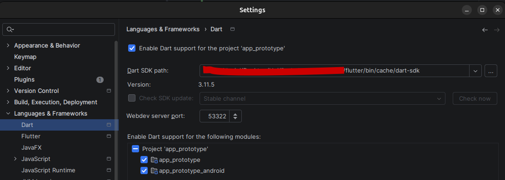
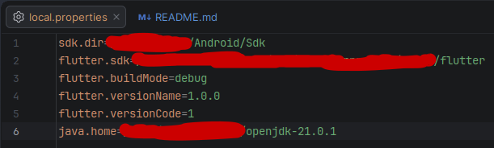

# app_prototype

Dieses Flutter-Projekt ist der Prototyp einer alltagstauglichen Assistenz-App, die personalisierte Übungsempfehlungen bereitstellt. Der technologische Kern des Projekts liegt in der intelligenten Verknüpfung einer semantischen Wissensbasis (Knowledge Graph) mit einer intuitiven, barrierefreien Benutzeroberfläche.

## Getting Started

This project is a starting point for a Flutter application.

A few resources to get you started if this is your first Flutter project:

- [Learn Flutter](https://docs.flutter.dev/get-started/learn-flutter)
- [Write your first Flutter app](https://docs.flutter.dev/get-started/codelab)
- [Flutter learning resources](https://docs.flutter.dev/reference/learning-resources)

For help getting started with Flutter development, view the
[online documentation](https://docs.flutter.dev/), which offers tutorials,
samples, guidance on mobile development, and a full API reference.

## Setup
### Software

* **Apache Jena Fuseki**
    * Hostet den Knowledge Graph und wird von der API angesprochen.
    * Download: https://jena.apache.org/download/
  
* **Java 21 JDK**
    * Für die Android-Plattform notwendig.
    * Download: https://developer.android.com/studio/install?hl=de
      
* **Flutter SDK**
    * Für UI und API-Calls notwendig.
    * Download: https://flutter.dev/docs/get-started/install
    * Falls Flutter das falsche JDK verwendet: `flutter config --jdk-dir <PFAD_ZUM_JDK>`
    * Abhängigkeiten installieren: `flutter pub get`
* **Android Studio**
    * Wird für Android-Emulatoren benötigt.
    * Starten über: `android-studio/bin/studio.sh`
      oder unter Windows: `studio.exe`
    * Emulator anlegen: `More Actions > Virtual Device Manager > Create Device`
      * Empfehlung:
          * Genügend CPU-Kerne zuweisen
          * Graphics Acceleration auf **Hardware** stellen
      * Bei Problemen mit der Emulator-Performance:
          * GPU-Treiber prüfen
          * Hardwarebeschleunigung aktivieren

* **iOS** ⚠️ **TODO**
    * Bisher nicht getestet.
    * Nur auf Apple-Hardware möglich, da Xcode benötigt wird.

---

### IDEs
#### IntelliJ IDEA

1. Projekt öffnen
2. Flutter- und Dart-Plugin installieren
3. Projekt konfigurieren: `Project Structure > Project`
   * **SDK:** `Oracle OpenJDK 21`
   * **Language Level:** `21`
<details>
    <summary><strong>Bild anzeigen (zum Öffnen klicken)</strong></summary>
    <div style="border: 1px solid #ddd; padding: 12px; border-radius: 8px; margin-top: 10px;">
        
    </div>
</details>

4. Dart konfigurieren: `Settings > Languages & Frameworks > Dart`
   * Dart Support aktivieren
   * Dart SDK Path setzen
   * Dart Support für das Projekt aktivieren
<details>
    <summary><strong>Bild anzeigen (zum Öffnen klicken)</strong></summary>
    <div style="border: 1px solid #ddd; padding: 12px; border-radius: 8px; margin-top: 10px;">
        
    </div>
</details>

5. Abhängigkeiten installieren: `flutter pub get`.
Danach IntelliJ gegebenenfalls neu starten.

6. Erwartete IDE-Ansicht: Nach erfolgreicher Einrichtung sollte Intellij wie folgt aussehen:
<details>
    <summary><strong>Bild anzeigen (zum Öffnen klicken)</strong></summary>
    <div style="border: 1px solid #ddd; padding: 12px; border-radius: 8px; margin-top: 10px;">
        
    </div>
</details>

---

#### Visual Studio Code ⚠️ **TODO**

#### Andere IDEs ⚠️ **TODO**

---

### Server starten
#### Apache Jena Fuseki starten
Lokalen Fuseki-Server starten:
```bash
<PREFIX_PATH>/apache-jena-fuseki-6.1.0/fuseki-server --file=../../raw_data/dummy_graph.ttl /rehab_dummy
```
* Server läuft auf: `http://localhost:3030`
* Über das Webinterface können SPARQL-Queries gegen die Ontologie ausgeführt werden.

Uni-Server: ⚠️ **TODO**

---

### Emulator starten
#### Android Emulator
- Verfügbare Emulatoren anzeigen: `flutter emulators` oder über den **Virtual Device Manager** in Android Studio.
- Emulator starten: `flutter emulators --launch <GERÄTE_ID>`
- Emulator mit Logging starten: `<PREFIX_PATH>/Android/Sdk/emulator/emulator -avd <GERÄTE_ID> -verbose`

#### iOS Emulator ⚠️ **TODO**

---

### Anwendung starten
### Webanwendung
Empfehlung für den ersten Start um zu prüfen, ob das Projekt korrekt eingerichtet wurde. 
1. Browser als Zielplattform auswählen
2. `main.dart` ausführen

### Android
<strong>local.properties konfigurieren</strong><br>
Damit Android-Builds funktionieren, muss die Datei `android/local.properties` im Projektverzeichnis 
angepasst werden.
<details>
    <summary><strong>Bild anzeigen (zum Öffnen klicken)</strong></summary>
    <div style="border: 1px solid #ddd; padding: 12px; border-radius: 8px; margin-top: 10px;">
        
    </div>
</details>

<strong>local.properties anlegen</strong><br>
Falls die Datei noch nicht existiert: `flutter build appbundle`. Dadurch wird sie automatisch erzeugt.
Alternativ kann sie manuell angelegt werden.

<strong>App-Icons generieren</strong><br>
Die App benötigt Launcher Icons. Diese werden automatisch aus einem Basisbild generiert:

1. Stelle sicher, dass `flutter_launcher_icons.yaml` im Projektverzeichnis existiert
2. Stelle sicher, dass ein Icon in `assets/icon/icon.png` (mind. 512x512px) vorhanden ist
3. Icons generieren:
   ```bash
   dart run flutter_launcher_icons:main
   ```

<strong>Anwendung starten</strong>
1. Android Emulator starten:
   ```bash
   flutter emulators --launch <GERÄTE_ID>
   ```
2. Dependencies installieren (falls noch nicht gemacht):
   ```bash
   flutter pub get
   ```
3. App starten:
   ```bash
   flutter run
   ```

### iOS ⚠️ **TODO**
1. iOS-Plattform auswählen
2. `main.dart` ausführen

---

## Derry Script Manager - Usage Guide

Der **Derry Script Manager** ist eine Sammlung von Shortcut-Kommandos
zur Automatisierung von Entwicklungsprozessen rund um:

-   Apache Jena Fuseki Knowledge Graph Server
-   Android Emulator / Flutter Development
-   Flutter App Execution (Web & Mobile)

------------------------------------------------------------------------

### Installation (Pflicht)

Damit die Derry-Kommandos genutzt werden können, muss Derry global
installiert sein:

``` bash
dart pub global activate derry
```

Stelle sicher, dass `dart` auf dem System installiert ist.

### Installation (Empfehlung)
#### Robot zur Ontology Konvertierung

Für die zuverlässige Konvertierung von Ontologien aus Protégé (`.owx` / `.owl`) in ein für Apache Jena Fuseki kompatibles Knowledge Graph Format (`.ttl`) wird das Tool **Robot** empfohlen.

Robot kann hier installiert werden:
https://robot.obolibrary.org/

#### Zweck
- Konvertiert Ontologien aus Protégé (`.owx` / `.owl`)
- Ausgabe als Turtle (`.ttl`) für Apache Jena Fuseki
- Vermeidet potenzielle Importfehler, die bei direktem Laden von `.owx` in Fuseki auftreten können

#### Warum Robot?
Apache Jena Fuseki kann bei direkten Imports von Protégé-Dateien (`.owx`) unerwartete Fehler oder Inkompatibilitäten verursachen.  
Robot ist ein etabliertes und zuverlässiges Tool im Bereich Ontologie-Processing und sorgt für eine konsistente und saubere Konvertierung in RDF/Turtle.

#### Hinweis
Nach der Installation kann Robot z. B. wie folgt manuell genutzt werden:

```bash
robot convert --input ontology.owl --output ontology.ttl
```

------------------------------------------------------------------------

### Notwendige Umgebungsvariablen

Derry unterstützt nur einfache Parameter am Ende der Kommandos.\
Daher müssen folgende Umgebungsvariablen zwingend gesetzt werden:

``` bash
# Pub Derry Script Manager REHAB
export FUSEKI_HOME="<PATH_PREFIX>/apache-jena-fuseki-6.1.0"
export ANDROID_SDK="<PATH_PREFIX>/Android/Sdk"
export ANDROID_DEFAULT_DEVICEID="<EMULATOR_DEVICEID>" # flutter emulators > ID
```
Empfehlung:
- Linux/macOS: in `~/.bashrc` oder `~/.zshrc` eintragen, damit sie
dauerhaft verfügbar sind.
- Windows: Über die UI für Umgebungsvariabeln eintragen

------------------------------------------------------------------------

### Wichtige Grundregel für Parameter

Derry kann keine Parameter mitten im Command verarbeiten.\
Deshalb gilt:

> Alle dynamischen Werte (z. B. Device IDs oder Emulator IDs) müssen mit
> `--` am Ende übergeben werden.

### Beispiel:

``` bash
derry app:phone -- emulator-5554
```

------------------------------------------------------------------------

### Start-Reihenfolge der gesamten Anwendung

Wenn die komplette Entwicklungsumgebung gestartet werden soll, muss die
Reihenfolge strikt eingehalten werden:

#### 1. Fuseki Knowledge Graph Server starten

``` bash
derry fuseki:run
```
oder um lokale Änderungen in der Ontologie einzubinden
``` bash
derry fuseki:start
```

------------------------------------------------------------------------

#### 2. Android Emulator starten (optional je nach Zielplattform Phone oder Web)

#### Default Android Emulator:

``` bash
derry emu:run:android
```

#### Oder mit spezifischer Device ID:

``` bash
derry emu:run -- <GeräteID>
```

------------------------------------------------------------------------

#### 3. Flutter App starten

#### Web (Chrome):

``` bash
derry app:chrome
```

#### Android Emulator (laufende Device Instanz):

``` bash
derry app:phone:android
```

#### Android Emulator (spezifische Device ID):

``` bash
derry app:phone -- emulator-5554
```

------------------------------------------------------------------------

### Fuseki & Ontology Kommandos

#### Ontologie in Turtle Format konvertieren

``` bash
derry fuseki:convert
```

------------------------------------------------------------------------

#### Fuseki Server starten (mit Knowledge Graph)

``` bash
derry fuseki:start
```

------------------------------------------------------------------------

### Android Emulator Kommandos

#### Liste aller Emulatoren anzeigen

``` bash
derry emu:list
```

------------------------------------------------------------------------

#### Emulator starten

#### Mit spezifischer Device ID:

``` bash
derry emu:run -- <GeräteID>
```

#### Log-Modus (Verbose + GPU Host):

``` bash
derry emu:log -- <GeräteID>
```

#### Default Emulator starten:

``` bash
derry emu:log:android
```

------------------------------------------------------------------------

### Flutter App Kommandos

#### Verfügbare Geräte anzeigen

``` bash
derry devices:list
```

------------------------------------------------------------------------

#### App starten

#### Chrome:

``` bash
derry app:chrome
```

#### Android Emulator (spezifisch):

``` bash
derry app:phone -- emulator-5554
```

#### Android Default Device:

``` bash
derry app:phone:android
```

------------------------------------------------------------------------

### Zusammenfassung

Der typische Workflow sieht so aus:

1.  Fuseki Server starten
2.  Emulator starten (optional je nach Plattform)
3.  Flutter App starten

------------------------------------------------------------------------

### ⚠️ Hinweise

- Alle Kommandos setzen korrekt konfigurierte ENV-Variablen voraus
- Device IDs müssen korrekt aus `flutter devices` oder `flutter emulators` entnommen werden
- Reihenfolge beim Starten der Umgebung ist zwingend einzuhalten
- <b>Die Flutter App kann über die IDE Plugins gestartet werden</b>