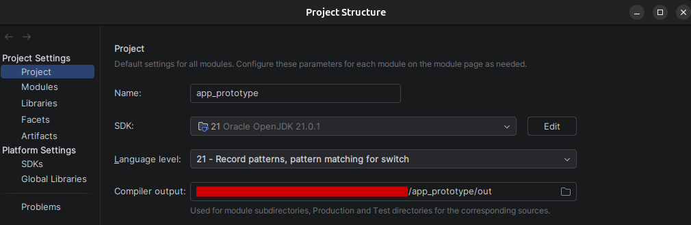
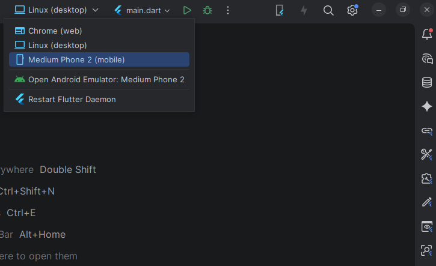

# app_prototype

Dieses Flutter-Projekt ist der Prototyp einer alltagstauglichen Assistenz-App, die personalisierte Übungsempfehlungen bereitstellt. Der technologische Kern des Projekts liegt in der intelligenten Verknüpfung einer semantischen Wissensbasis (Knowledge Graph) mit einer intuitiven, barrierefreien Benutzeroberfläche.

## Getting Started

This project is a starting point for a Flutter application.

A few resources to get you started if this is your first Flutter project:

- [Learn Flutter](https://docs.flutter.dev/get-started/learn-flutter)
- [Write your first Flutter app](https://docs.flutter.dev/get-started/codelab)
- [Flutter learning resources](https://docs.flutter.dev/reference/learning-resources)

For help getting started with Flutter development, view the
[online documentation](https://docs.flutter.dev/), which offers tutorials,
samples, guidance on mobile development, and a full API reference.

## Setup
### Software

* **Apache Jena Fuseki**
    * Hostet den Knowledge Graph und wird von der API angesprochen.
    * Download: https://jena.apache.org/download/
  
* **Java 21 JDK**
    * Für die Android-Plattform notwendig.
    * Download: https://developer.android.com/studio/install?hl=de
      
* **Flutter SDK**
    * Für UI und API-Calls notwendig.
    * Download: https://flutter.dev/docs/get-started/install
    * Falls Flutter das falsche JDK verwendet: `flutter config --jdk-dir <PFAD_ZUM_JDK>`
* **Android Studio**
    * Wird für Android-Emulatoren benötigt.
    * Starten über: `android-studio/bin/studio.sh`
      oder unter Windows: `studio.exe`
    * Emulator anlegen: `More Actions > Virtual Device Manager > Create Device`
      * Empfehlung:
          * Genügend CPU-Kerne zuweisen
          * Graphics Acceleration auf **Hardware** stellen
      * Bei Problemen mit der Emulator-Performance:
          * GPU-Treiber prüfen
          * Hardwarebeschleunigung aktivieren

* **iOS** ⚠️ **TODO**
    * Bisher nicht getestet.
    * Nur auf Apple-Hardware möglich, da Xcode benötigt wird.

---

### IDEs
#### IntelliJ IDEA

1. Projekt öffnen
2. Flutter- und Dart-Plugin installieren
3. Projekt konfigurieren: `Project Structure > Project`
   * **SDK:** `Oracle OpenJDK 21`
   * **Language Level:** `21`
<details>
    <summary><strong>Bild anzeigen (zum Öffnen klicken)</strong></summary>
    <div style="border: 1px solid #ddd; padding: 12px; border-radius: 8px; margin-top: 10px;">
        
    </div>
</details>

4. Dart konfigurieren: `Settings > Languages & Frameworks > Dart`
   * Dart Support aktivieren
   * Dart SDK Path setzen
   * Dart Support für das Projekt aktivieren
<details>
    <summary><strong>Bild anzeigen (zum Öffnen klicken)</strong></summary>
    <div style="border: 1px solid #ddd; padding: 12px; border-radius: 8px; margin-top: 10px;">
        
    </div>
</details>

5. Abhängigkeiten installieren: `flutter pub get`.
Danach IntelliJ gegebenenfalls neu starten.

6. Erwartete IDE-Ansicht: Nach erfolgreicher Einrichtung sollte Intellij wie folgt aussehen:
<details>
    <summary><strong>Bild anzeigen (zum Öffnen klicken)</strong></summary>
    <div style="border: 1px solid #ddd; padding: 12px; border-radius: 8px; margin-top: 10px;">
        
    </div>
</details>

---

#### Visual Studio Code ⚠️ **TODO**

#### Andere IDEs ⚠️ **TODO**

---

### Server starten
#### Apache Jena Fuseki starten
Lokalen Fuseki-Server starten:
```bash
<PREFIX_PATH>/apache-jena-fuseki-6.1.0/fuseki-server/fuseki-server --file=../../raw_data/dummy_graph.ttl /rehab_dummy
```
* Server läuft auf: `http://localhost:3030`
* Über das Webinterface können SPARQL-Queries gegen die Ontologie ausgeführt werden.

Uni-Server: ⚠️ **TODO**

---

### Emulator starten
#### Android Emulator
- Verfügbare Emulatoren anzeigen: `flutter emulators` oder über den **Virtual Device Manager** in Android Studio.
- Emulator starten: `flutter emulators --launch <GERÄTE_ID>`
- Emulator mit Logging starten: `<PREFIX_PATH>/Android/Sdk/emulator/emulator -avd <GERÄTE_ID> -verbose`

#### iOS Emulator ⚠️ **TODO**

---

### Anwendung starten
### Webanwendung
Empfehlung für den ersten Start um zu prüfen, ob das Projekt korrekt eingerichtet wurde. 
1. Browser als Zielplattform auswählen
2. `main.dart` ausführen

### Android
<strong>local.properties konfigurieren</strong><br>
Damit Android-Builds funktionieren, muss die Datei `android/local.properties` im Projektverzeichnis 
angepasst werden.
<details>
    <summary><strong>Bild anzeigen (zum Öffnen klicken)</strong></summary>
    <div style="border: 1px solid #ddd; padding: 12px; border-radius: 8px; margin-top: 10px;">
        
    </div>
</details>

<strong>local.properties anlegen</strong><br>
Falls die Datei noch nicht existiert: `flutter build appbundle`. Dadurch wird sie automatisch erzeugt.
Alternativ kann sie manuell angelegt werden.

<strong>Anwendung starten</strong>
1. Android Emulator starten
2. Emulator als Zielplattform auswählen
3. `main.dart` ausführen

### iOS ⚠️ **TODO**
1. iOS-Plattform auswählen
2. `main.dart` ausführen

---

## Ausblick
### Derry Script Manager
In Zukunft soll der Derry Script Manager das Starten aller notwendigen Komponenten vereinfachen.